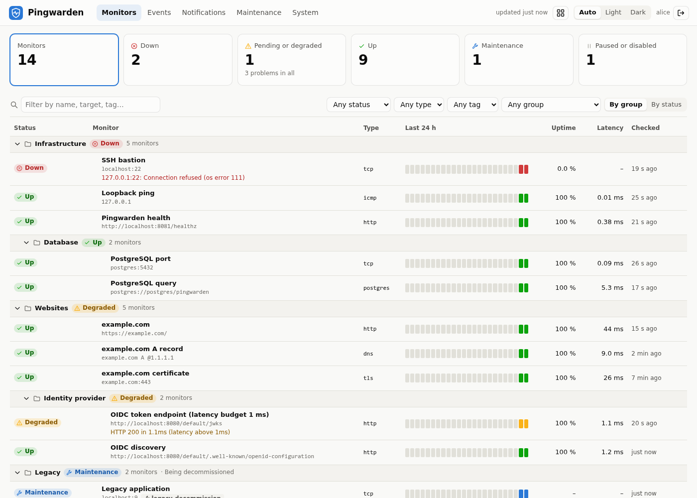

# Pingwarden UI

A dashboard for [Pingwarden](https://github.com/sebastka/pingwarden), the headless uptime monitor:
every monitor with its live state and history, status changes, notifiers and their delivery log,
maintenance windows, and a board for wall displays.

> [!NOTE]
> This project was created with [Anthropic Claude Opus 5.5](https://www.anthropic.com/claude).



- **Monitors**: live status, grouped by Pingwarden's groups (or sorted by severity), with a 24-hour
  history bar, uptime, latency and last check. Filter by text, status, type, tag or group; save
  filter sets as views and pin monitors to the top (kept in the browser). Acknowledged and
  silenced monitors are marked.
- **Monitor details**: status and since when, the last message, dependencies and their state,
  notifiers, maintenance, certificate expiry, SLO and error budget; uptime over 24 hours, 7 days,
  30 days and 1 year; latency and status over 24 hours to 1 year (with a data table); raw checks,
  status changes, the notifications sent about it, and its effective configuration.
- **Events**: every status change, with how long each state lasted, outages and total downtime,
  and why a change was not notified (dependency down, flapping, maintenance, silence).
- **Reliability**: per month (or the last 30 days), each monitor's uptime against its SLO, the
  error budget used, outages, downtime, MTTR and MTBF. Export as CSV, or print to PDF.
- **Certificates**: every TLS certificate by expiry date.
- **Dependencies**: the `depends_on` graph, coloured by status.
- **Notifications**: each notifier with its delivery rate, last result and last error; monitors
  that notify nobody; the full delivery log.
- **Maintenance**: windows from the configuration and ad-hoc ones, whether they are active and
  until when, and the monitors they cover. Start a window for monitors, groups, tags or
  everything, and end it early.
- **System**: Pingwarden's version, leadership and database; groups and tags.
- **Board**: every monitor as a tile, problems first and larger, for a wall display; with
  several Pingwarden instances, all of them on one board.
- **Live**: changes arrive through Pingwarden's event stream (polling with an older
  Pingwarden). Optional desktop notifications and a sound when a monitor goes down.
- **Actions** (when allowed): check now, pause and resume, acknowledge (stops reminders until
  the monitor recovers), silence notifications for a while, start or end maintenance, send a
  test notification, reload Pingwarden's configuration.
- **Several Pingwarden instances** in one dashboard, with a switcher.

The browser only talks to this dashboard; the dashboard talks to Pingwarden. Pingwarden's API
can stay on an internal network and needs no CORS.

Acknowledging, silencing, ad-hoc maintenance, SLOs, the live stream, monitor configurations and
"who may act" need a Pingwarden with its `/api/v1/me` endpoint; with an older one, the dashboard
leaves those out and polls.

## Quick start

Requires Node 26 (`.nvmrc`) and a Pingwarden with an API token of `read` scope.

```sh
npm ci
cp .env.example .env        # then set PINGWARDEN_URL, AUTH_MODE and its settings
npm run build
npm start                   # http://127.0.0.1:3000
```

Or with Docker:

```sh
docker run --rm -p 3000:3000 --env-file .env ghcr.io/sebastka/pingwarden-ui:latest
```

## Access

Choose one with `AUTH_MODE`; see [.env.example](.env.example) for every option.

### `AUTH_MODE=oidc`: users sign in

Users sign in with your identity provider (authorization code flow with PKCE). The dashboard
keeps their tokens on the server side and calls Pingwarden with each user's own access token.
**Pingwarden decides** who may read and who may act, with its `server.auth.oidc` settings:

```yaml
# Pingwarden
server:
  auth:
    oidc:
      issuer: https://auth.example.com/realms/home
      audience: pingwarden
      claim: realm_access.roles
      read: [pingwarden-read]
      admin: [pingwarden-admin]
```

```sh
# Dashboard
AUTH_MODE=oidc
PINGWARDEN_URL=http://pingwarden:8080
PUBLIC_URL=https://status.example.com
OIDC_ISSUER=https://auth.example.com/realms/home
OIDC_CLIENT_ID=pingwarden-ui
OIDC_CLIENT_SECRET=…
```

- Register a client with the redirect URI `PUBLIC_URL/auth/callback` (and the post-logout
  redirect URI `PUBLIC_URL/auth/logged-out` for single sign-out).
- Its **access tokens must carry Pingwarden's audience**: with Keycloak, add an audience mapper
  (_Included Custom Audience_: `pingwarden`) to the client; with Authentik, use the same
  provider for both. Providers that take an audience or resource parameter instead (Auth0,
  RFC 8707) get it from `OIDC_AUTH_PARAMS=audience=pingwarden`.
- A user Pingwarden refuses (no `read` or `admin` role, wrong audience) gets no session and
  sees why. Who may act is asked of Pingwarden (`/api/v1/me`): users with read access see the
  actions greyed out.
- With several instances, each must accept the provider's tokens (same issuer and audience).
- Sessions live in memory: a restart signs everyone out (the next page load goes through the
  provider again, usually without a prompt). Run one instance, or use sticky sessions.

### `AUTH_MODE=token`: no sign-in

The dashboard reads Pingwarden with `PINGWARDEN_TOKEN`, a token from Pingwarden's
`server.api_tokens` (or none, with its `anonymous_read`). Anyone who can reach the dashboard
sees everything in it, so it is **read-only** unless `READ_ONLY=false` (the token's scope then
decides). Meant for a wall display or a trusted network; the token never reaches the browser.

```yaml
# Pingwarden
server:
  api_tokens:
    - name: dashboard
      token: ${PINGWARDEN_DASHBOARD_TOKEN}
      scope: read
```

```sh
# Dashboard
AUTH_MODE=token
PINGWARDEN_URL=http://pingwarden:8080
PINGWARDEN_TOKEN=…
```

## Configuration

| Variable                                              | Meaning                                                                   |
| ----------------------------------------------------- | ------------------------------------------------------------------------- |
| `PINGWARDEN_URL`                                      | Pingwarden's base URL, e.g. `http://pingwarden:8080` (required)           |
| `PINGWARDEN_NAME`                                     | Its name in the UI (default: the URL's host)                              |
| `PINGWARDEN_<n>_URL`, `_NAME`, `_ID`, `_TOKEN`        | Several instances, instead of the single-instance variables               |
| `AUTH_MODE`                                           | `oidc` or `token` (required)                                              |
| `PINGWARDEN_TOKEN`                                    | API token for `AUTH_MODE=token`                                           |
| `READ_ONLY`                                           | Never relay actions; default `true` with `token`, `false` with `oidc`     |
| `PUBLIC_URL`                                          | The dashboard's external URL; required with `oidc`                        |
| `OIDC_ISSUER`, `OIDC_CLIENT_ID`, `OIDC_CLIENT_SECRET` | The client at your provider (no secret: a public client)                  |
| `OIDC_TOKEN_AUTH_METHOD`                              | `client_secret_basic` (default with a secret), `_post`, `_jwt`, `none`    |
| `OIDC_SCOPES`, `OIDC_AUTH_PARAMS`                     | Requested scopes (`openid profile email`); extra authorization parameters |
| `SESSION_TTL_HOURS`                                   | Sign in again after this long (12)                                        |
| `LISTEN_HOST`, `PORT`                                 | Default `127.0.0.1:3000` (`0.0.0.0` in the image)                         |
| `ALLOWED_HOSTS`                                       | Host names accepted besides localhost and `PUBLIC_URL`'s (`*` = any)      |
| `REFRESH_SECONDS`, `PINGWARDEN_TIMEOUT_SECONDS`       | Refresh without the live stream (15); Pingwarden request timeout (10)     |
| `FRAME_ANCESTORS`                                     | Origins that may embed the dashboard in a frame (default: none)           |

A mistake stops the server with a list of every problem.

## Security

- **Tokens stay on the server**: the API token, users' access and refresh tokens. The browser
  holds an `HttpOnly`, `SameSite=Lax` session cookie (`Secure` with an `https` `PUBLIC_URL`).
- **Pingwarden authorises everything** with OIDC: the dashboard forwards the user's token and
  never grants more than Pingwarden does. It only relays an explicit list of endpoints, with
  validated identifiers and query parameters.
- **Actions** are logged (`[action] oidc:alice on main: pause web → HTTP 200`), and Pingwarden logs
  them with the caller too.
- **CSRF**: changes must be same-origin (Fetch Metadata / `Origin`) and carry an
  `X-Pingwarden-UI` header, which forms on other sites cannot send.
- **DNS rebinding**: requests for other host names than localhost, `PUBLIC_URL`'s host and
  `ALLOWED_HOSTS` are refused (this matters for `AUTH_MODE=token`, which has no login).
- **Content Security Policy**: no inline script or style, no framing unless `FRAME_ANCESTORS`
  lists the embedding sites. Embedding works in token mode; with OIDC only on the same site,
  since the session cookie is `SameSite=Lax`.
- **Per-browser data**: saved views, pinned monitors, the theme and alert settings live in the
  browser's storage, never on the server.

## Development

```sh
npm ci
npm run dev:pingwarden   # Pingwarden + PostgreSQL + a mock OIDC provider (Docker)
npm run dev              # API on :3000 (watch mode) + Vite on http://localhost:5173
npm run check            # typecheck, lint, format check, tests
```

`npm run dev:pingwarden` starts [compose.yaml](compose.yaml): a real Pingwarden on
`localhost:8081` with monitors in every state ([dev/pingwarden](dev/pingwarden)), and a
[mock OIDC provider](https://github.com/navikt/mock-oauth2-server) on `localhost:8090` that
accepts any user name. Its claims box decides the roles: `{"roles": ["pingwarden-admin"]}`
or `{"roles": ["pingwarden-read"]}`. The `.env.example` defaults use it (token mode; the OIDC
block is commented). With `TEST_PINGWARDEN_URL=http://localhost:8081`, `npm test` also runs
the end-to-end tests against it, OIDC sign-in included.

The types of Pingwarden's API are in [src/shared/pingwarden.ts](src/shared/pingwarden.ts);
[test/openapi.test.ts](test/openapi.test.ts) compares them with a copy of Pingwarden's
OpenAPI spec in `test/fixtures`. Design decisions are in [DECISIONS.md](DECISIONS.md).

## License

[MIT](LICENSE)
